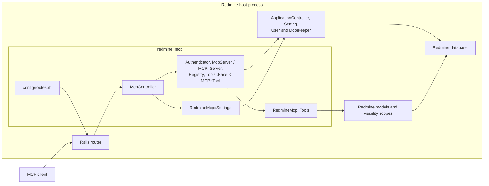
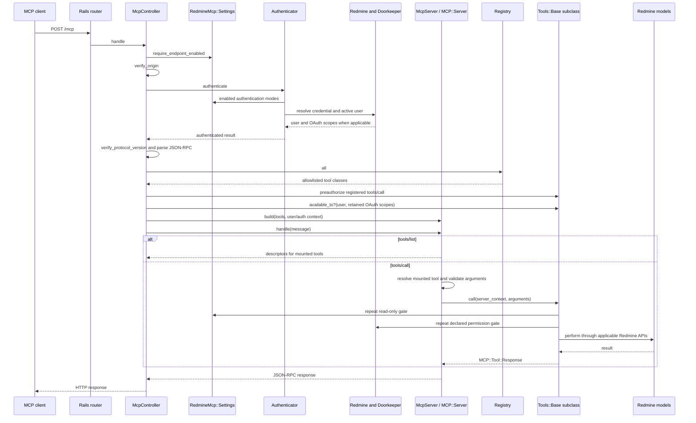
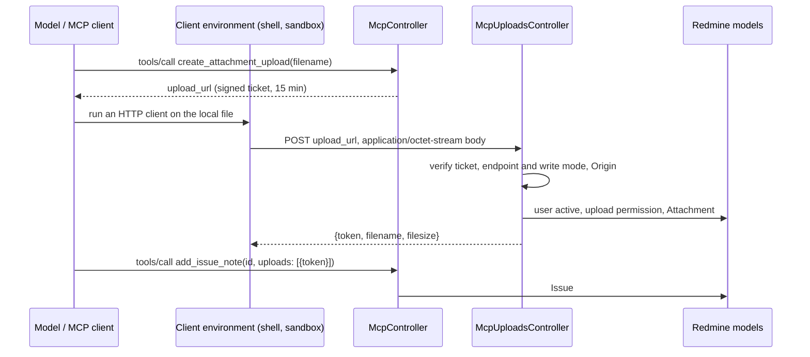

# Plugin architecture

This document describes the architecture implemented in this repository. The
plugin runs inside the Redmine process: it owns the MCP HTTP adapter and tools,
while Redmine supplies the application runtime, identities, authorization,
records, persistence, and test environment. Capabilities not represented below
are outside the current implementation.

For change-specific instructions, read the [MCP core agent guide](docs/mcp-core.md).

## Runtime boundary

The boxes inside `redmine_mcp` correspond to code owned here:

- [`config/routes.rb`](config/routes.rb) mounts the transport, OAuth metadata,
  and optional dynamic-registration routes into the Rails router.
- [`McpController`](app/controllers/mcp_controller.rb) is the HTTP and security
  boundary for `/mcp`.
- [`McpUploadsController`](app/controllers/mcp_uploads_controller.rb) receives
  file bytes at `/mcp/uploads`, authenticated only by a signed upload ticket (see
  [Attachment uploads](#attachment-uploads)).
- [`Authenticator`](lib/redmine_mcp/authenticator.rb),
  [`McpServer`](lib/redmine_mcp/mcp_server.rb),
  [`Registry`](lib/redmine_mcp/registry.rb), and
  [`Tools::Base`](lib/redmine_mcp/tools/base.rb) form the live MCP
  core around the SDK's `MCP::Server` and `MCP::Tool`.
- Classes under [`RedmineMcp::Tools`](lib/redmine_mcp/tools/) adapt
  MCP operations to Redmine models.
- [`RedmineMcp::Settings`](lib/redmine_mcp/settings.rb) is a typed
  adapter over Redmine's plugin settings.

The remaining boxes are supplied by the host. Rails provides routing, controller
callbacks, rendering, and the `ApplicationController` base class. Redmine provides
`Setting`, `User`, permissions, models, visibility scopes, the database connection,
and the plugin loader. Redmine's Doorkeeper integration authenticates OAuth access
tokens. The plugin does not duplicate those services or maintain a separate user or
record store.

## MCP request flow

`POST /mcp` follows this path. The order is part of the security boundary.

The symbols in the sequence are implemented as follows:

1. The Rails router uses [`config/routes.rb`](config/routes.rb) to send `POST`
   to `McpController#handle`. `GET` and `DELETE` reach `#stream` and `#terminate`,
   which return 405 after the shared controller gates because the server provides
   neither a server-to-client stream nor transport sessions.
2. `McpController` runs `require_endpoint_enabled`, `verify_origin`,
   `authenticate_mcp_request`, and `verify_protocol_version` in that order before
   `#handle` parses JSON. It rejects malformed JSON, batches, invalid JSON-RPC
   bodies that are not objects or lack a nonblank method, envelopes whose `jsonrpc`
   member is not `"2.0"`, and unsupported transport versions; notifications receive
   an empty 202 response.
3. `Authenticator#authenticate` tries only administrator-enabled mechanisms, in
   the order OAuth2, API key, HTTP Basic, then session cookie. It returns an active
   Redmine `User`; OAuth also copies the token scopes to that user and retains them
   in the request authentication context.
4. `McpController#verify_protocol_version` validates a supplied
   `MCP-Protocol-Version` header. The SDK negotiates `initialize` requests and
   modern per-request envelopes. Supported transport revisions live in
   [`lib/redmine_mcp.rb`](lib/redmine_mcp.rb).
5. `Registry.all` is the explicit allowlist of tool classes. For a registered
   `tools/call`, the controller resolves every permission required by that
   invocation, including argument-dependent permissions. It rejects read-only
   and role denials with a plain HTTP 403, or an OAuth scope denial with the
   challenge composed by
   [`ScopeChallenge`](lib/redmine_mcp/scope_challenge.rb). Unknown tool
   names continue to the SDK.
6. The controller applies `Tools::Base.available_to?` before mounting tools on
   a request-local server.
7. [`McpServer`](lib/redmine_mcp/mcp_server.rb) configures the SDK's
   exception reporter and builds an `MCP::Server` with the filtered tools plus
   the authenticated user and authorization context. `MCP::Server#handle`
   handles `server/discover`, `initialize`, `tools/list`, `tools/call`, `ping`,
   JSON-RPC errors, negotiation, and schema validation.
8. `Tools::Base#run` repeats the write and permission gates after SDK argument
   validation as a defense-in-depth backstop, then calls the subclass's
   `#perform` method.
9. Each tool reads or writes through Redmine models. Tools use Redmine visibility
   APIs such as `Project.visible`, `Issue.visible`, `Principal.visible`,
   `WikiPage#visible?`, visible custom fields, and visible journals, together with
   `User#allowed_to?` where the operation requires a permission.

### Transport-free SDK seam

The plugin does not mount an SDK transport. Rails routing, HTTP status codes,
authentication, Origin checks, request-body parsing, transport-version headers,
and response rendering remain in `McpController`. After those gates, the
controller passes the parsed message directly to `MCP::Server#handle` and renders
the returned Hash. `McpServer.build` is therefore the transport-free composition
seam: it supplies server identity, the exception reporter, caller-visible tool
classes, the prompt set, the attachment resource template and its `resources/read`
handler, and the authenticated `server_context`, but no Rack, SSE, or session
adapter. Keep SDK-backed tools, prompts, and resources independent of Rails request
and response objects.

### Prompts

[`McpServer.build`](lib/redmine_mcp/mcp_server.rb) mounts the prompts from
[`Prompts.all`](lib/redmine_mcp/prompts.rb) and declares the `prompts`
capability. It does not declare the `completions` capability or install a
`completion/complete` handler because neither prompt offers argument completion. A
[`Prompts::Base`](lib/redmine_mcp/prompts/base.rb) subclass renders
instruction text for `prompts/get` with its argument values substituted as inert
data; it performs no Redmine access of its own, so prompts carry no per-user
discovery gate and the read tools their instructions name stay independently
authorized. Unlike a tool, a prompt therefore cannot widen what its caller may see.

Administrators can replace each prompt's text, and the server instructions,
from the plugin settings' Prompts tab (tool descriptions have their own tab, see
the security invariants below); the built-in text is the fallback
(`Settings.text`). The edited text is trusted administrator input. The caller's
request section is still generated by the prompt class and placed at the
`{{request}}` marker, or appended when the marker is missing, so an edit
changes the instructions but not how the request is framed as data.

The request is serialized losslessly as one inert JSON string with no server-side
validation: the server never dereferences it, both rendered skills are read-only,
and every named read tool remains independently authorized. JSON string encoding
keeps newlines, markup delimiters, and command-like text inside the data boundary.
`qa_ticket_history_report` resolves
project/category/version/date scope conversationally, asks for a bound or a missing
date endpoint instead of rejecting the invocation, and proposes returned/reproved
statuses from `list_statuses` for the user to confirm. Its business-hour baseline
uses America/Sao_Paulo, Monday-Friday 09:00-12:00 and 13:00-18:00, excludes
weekends, does not account for holidays, and leaves an open issue's current-owner
interval ongoing and outside totals rather than synthesizing a cutoff.

### Resources and attachments

The server declares the `resources` capability for one resource type: the bytes
of a file attached to a visible issue. The capability is deliberately minimal --
no `subscribe`, no `listChanged` -- because attachment discovery is owned by
`get_issue`, not by resource enumeration. `resources/list` is an empty page and
`resources/templates/list` publishes the single dynamic template
`redmine://issues/{issue_id}/attachments/{attachment_id}`
([`Resources`](lib/redmine_mcp/resources.rb)). `get_issue` reports an
`attachments_count` in its normal shape and, when `include_attachments` is set,
returns one bounded page of attachment metadata (its own `attachments_offset`/
`attachments_limit`, the latter clamped by the result cap) rather than an unbounded
list. It surfaces the same URI per attachment as both metadata (`resource_uri`) and
a `resource_link` content block, so a client with a resource-selection UI picks the
bytes without the model restating the URI. Bytes never travel in a tool response, and the
credential-free `human_download_url` is only a manual browser fallback, never an
advertised client-fetchable resource.

[`McpServer.build`](lib/redmine_mcp/mcp_server.rb) mounts the template and
installs a `resources/read` handler that runs after authentication, so every read
resolves the issue through `Issue.visible`, re-checks `:view_issues` (OAuth scopes
included), confirms the attachment's container is exactly that issue, and applies
`Attachment#visible?`/`#readable?`. A URI is a name, not a capability: these
checks run on every read. Malformed, absent, invisible, unreadable, and
wrong-issue URIs all return the same `-32602`, so existence cannot be inferred;
unexpected I/O stays a sanitized internal error. One response is capped at 5 MiB
of raw bytes, checked against stored metadata and the file on disk before reading;
an over-cap but visible attachment returns the implementation-defined `-32001`
pointing at its `human_download_url`. Safe UTF-8 text returns as `text`;
everything else, including active formats such as HTML and SVG, returns as a
base64 `blob`. Reads use `ttlMs: 0` and `cacheScope: "private"` because
membership and attachment visibility can change. In OAuth mode `McpController`
offers a `view_issues` step-up before dispatch, mirroring the tool gate; the
challenged scope is request-level, so it discloses nothing about a specific
attachment.

### Attachment uploads

Uploads follow Redmine's own two-step REST model. First, the bytes become an
unattached `Attachment` authored by the caller, identified by Redmine's upload
token (`<id>.<digest>`). Then `create_issue`, `update_issue`, or `add_issue_note`
attaches it through an `uploads` argument (`token`, optional `filename`,
`description`, `content_type`). Three write tools produce a token. They differ
only in where the bytes come from:

| Tool | Source of the bytes | Exposed when |
|---|---|---|
| `create_attachment_upload` | The client's own environment, sent to a short-lived upload URL | Write mode |
| `upload_attachment_from_url` | A URL that the Redmine server downloads | Write mode and `url_upload_enabled` |
| `upload_attachment_content` | Base64 in the tool arguments, at most 64 KiB decoded | Write mode |

The first two keep file bytes out of the model's context. The third is a fallback
for small generated files when the client cannot reach Redmine over HTTP.

[`Uploads`](lib/redmine_mcp/uploads.rb) owns creating and attaching attachments,
[`UploadTicket`](lib/redmine_mcp/upload_ticket.rb) owns the upload URL's
signed ticket, and [`UrlFetcher`](lib/redmine_mcp/url_fetcher.rb) owns the
server-side download policy.

**Creating an upload** uses the gate Redmine applies to `attachments#upload`.
That action belongs to permissions such as `add_issues`, `edit_issues`, and
`add_issue_notes`. The check is `User#allowed_to?` on the action, so an OAuth
token's scopes narrow it the same way they narrow every other check. The upload
tools declare no single permission, so the controller issues no scope challenge
for them. Discovery hides them from a user whose role grants no upload
permission, and execution re-checks with the token's scopes. Redmine's
`Attachment` validations enforce the size limit (`attachment_max_size`) and the
allowed and denied extensions on every path.

**Attaching** runs under the target tool's own permission. For an existing issue
it also requires `Issue#attachments_addable?`. A token must name an unattached
attachment authored by the caller. Core's `Attachment.find_by_token` does not
check the author, and a token is only `id` plus the content's SHA-256, which
anyone who knows the file can derive. The plugin therefore adds the author check
and returns the same error for an unknown, attached, or foreign token. Attachments
that fail validation when renamed are reported instead of being silently dropped.
On `update_issue` and `add_issue_note`, the journal records the added files.
Uploads that are never attached are removed by Redmine's
`redmine:attachments:prune` task.

**The upload URL** is `POST /mcp/uploads?upload_token=…`, with the raw file as an
`application/octet-stream` body. The ticket is a purpose-scoped
`ActiveSupport::MessageVerifier` signature that expires after 15 minutes. It
covers the user id, the filename, the content type, and the OAuth scopes in force
when the ticket was issued. The endpoint accepts no other credential: no cookie,
no API key, no bearer token. At upload time it requires the MCP endpoint to be
enabled and read-only mode to be off. It also rejects a disallowed `Origin`
exactly like `/mcp`. It then re-resolves the user as active and re-checks the
upload permission with the recorded scopes. It rejects a declared
`Content-Length` above `attachment_max_size` before reading the body.

A ticket is not single-use. Within its lifetime it can create further unattached
uploads for the same user, but nothing else: attaching still requires an
authenticated MCP call as that user. The `upload_token` parameter is added to
Rails' parameter filter so the ticket does not reach request logs. The URL is
built from the base URL of the `/mcp` request that issued it. A client environment
without network access to Redmine, such as some hosted code sandboxes, cannot use
it and falls back to one of the other two tools.

**Server-side download** (`upload_attachment_from_url`) makes the Redmine server
an HTTP client, so it is an SSRF surface. Three settings, all with fail-closed
defaults, control it:

- `url_upload_enabled` (off): when off, the tool is hidden and refused.
- `url_upload_allowed_hosts` (empty): an optional list of exact host names or
  `*.example.com` subdomain patterns. An empty list admits any host.
- `url_upload_allow_private` (off): when off, every address that is not
  publicly routable is refused. This covers loopback, RFC 1918 private, link-local
  (including cloud metadata at `169.254.169.254`), CGNAT, unique-local IPv6,
  multicast, reserved and unspecified addresses, and their IPv4-mapped IPv6 forms.

Only `https` URLs are fetched. The host is resolved once, every resolved address
is checked, and the connection goes to the vetted address while TLS still
verifies the original host name, so DNS rebinding cannot swap the target after the
check. At most three redirects are followed, and each hop is validated again
(scheme, host list, address). No cookies, credentials, or Redmine headers are
sent. The body is streamed into a tempfile under connect and read timeouts and is
aborted as soon as it exceeds `attachment_max_size`.

Policy refusals name their reason. Connection-level failures return one uniform
message, so the tool cannot be used to scan ports. The URL is never logged,
because download links often embed a secret. Only links that work without the
user's own credentials can succeed, such as pre-signed download URLs.

### Error ownership

Errors retain one owner across the controller-to-SDK seam:

| Condition | Owner and wire result |
|---|---|
| Disabled endpoint, rejected Origin, or failed authentication | Controller HTTP error before MCP dispatch |
| Malformed JSON, a batch, an invalid JSON-RPC envelope, or an unsupported `MCP-Protocol-Version` header | Controller plus `JsonRpc`; HTTP 400 with the applicable JSON-RPC error |
| Unknown MCP method | SDK `MCP::Server#handle`; JSON-RPC method-not-found (`-32601`) |
| Registered tool denied by role or read-only mode | Controller; plain HTTP 403 with no scope challenge |
| Registered tool permitted by role but outside the OAuth token scope | Controller plus `ScopeChallenge`; HTTP 403 with an `insufficient_scope` challenge |
| Unknown tool | SDK `MCP::Server#handle`; JSON-RPC invalid-params (`-32602`) with the tool-not-found shape |
| SDK input-schema rejection | SDK tool result with `isError: true`; the tool body does not run |
| Expected `ToolError` or `PermissionError` from an executing tool | `Tools::Base#run`; `MCP::Tool::Response` encoded as a result with `isError: true` |
| Unexpected exception from an executing tool | SDK internal error (`-32603`); `McpServer` reports details to the Redmine log and the response stays sanitized |
| Upload URL request with a disabled endpoint, read-only mode, a rejected Origin, a bad ticket, a lost permission, a wrong content type, an oversized body, or an invalid attachment | `McpUploadsController`; plain HTTP 403, 401, 415, 413, or 422 with a JSON `error`, outside JSON-RPC |

Do not recreate SDK-owned envelopes or codes in plugin code. `JsonRpc` is limited
to errors that must be returned before `MCP::Server#handle` can safely run and to
recognizing notifications at the HTTP boundary.

## Security invariants

These invariants span components and must remain true when any layer changes.

### Authentication precedes protocol execution

The controller rejects a disabled endpoint and a disallowed `Origin` before it
resolves credentials. It authenticates before protocol parsing and dispatch, so no
MCP method executes anonymously. Within `Authenticator`, only enabled modes are
attempted, in declared priority order. If a mode recognizes an explicit credential
and rejects it, authentication fails rather than trying a lower-priority mode.
`User.current` is set only from a successful result.

OAuth2, API-key, and HTTP Basic authentication require Redmine's REST API setting
to be enabled. Session authentication does not use that switch. If all plugin
authentication modes are disabled, authentication fails closed.

### Every supplied Origin is checked

`McpController#verify_origin` runs before authentication for every MCP request. An
absent `Origin` is accepted for non-browser clients. A supplied value must exactly
match the Redmine base URL or an entry in `Settings.allowed_origins`. This check is
also the cross-site request guard for optional session-cookie authentication,
whose Rails CSRF callback cannot protect token-oriented MCP requests.

### Read-only mode is enforced at discovery and execution

`Tools::Base.available_to?` removes write tools before the request-local server
is built while `Settings.read_only?` is true. The controller also rejects a
forced call to a registered write tool with a plain HTTP 403 before SDK dispatch.
`Tools::Base#run` independently refuses a write tool, so execution stays
protected if the controller gate is bypassed or the setting changes after server
construction. Read-only mode defaults on.

### OAuth scopes narrow Redmine permissions

`Authenticator#try_oauth2` assigns the access token's scopes through
`User#oauth_scope=`. Discovery evaluates a tool's declared permission with that
scope narrowing temporarily cleared, then restores the retained scopes, so
`tools/list` reflects the user's role and exposes role-permitted tools for OAuth
step-up. For a registered `tools/call`, the controller first checks the role-only
axis for every permission the invocation requires. A role denial returns a plain
403 because no token can overcome it. If the role permits the operation but
`User#allowed_to?` fails with the retained OAuth scopes, the controller returns
`403 insufficient_scope` containing the complete operation scope set. For a
write operation whose administrator has no role-based path, the actionable scope
is `admin`, rather than individual permissions that cannot activate Redmine's
administrator authority. An admin-only read operation returns a plain 403 because
the only actionable scope is write-tier `admin`, which a read step-up must never
request. The authoritative correlation map and challenge format live in
[`ScopeChallenge`](lib/redmine_mcp/scope_challenge.rb). Its same-tier rule
prevents a read challenge from introducing write authority. The client can union
the challenged scopes with its current grant, re-authorize, and retry.

Tool execution still uses `User#allowed_to?` with the restored scopes as a
backstop and therefore intersects Redmine role permissions with the token's
narrower grant.
Tools that require a project-scoped permission beyond a visible lookup call
`Tools::Base#authorize!` against the selected project. API-key, Basic, and
session modes have no additional OAuth scope narrowing.

### Permissions and record visibility are separate gates

A tool's declared and argument-dependent permissions control whether the
operation is available; Redmine visibility APIs control which records it can
observe. Both are required because visibility scopes honor Redmine roles but do
not apply a narrowed OAuth token, and a permission check alone does not filter
records. Record lookups start from a visible scope, and project-specific
operations additionally authorize against that project where required. Nested
data uses its own visibility API where Redmine provides one.

Invisible and nonexistent records must remain indistinguishable. Helpers such as
`Tools::Base#fetch_project` and tools such as `GetIssue` return the same not-found
wording for both cases, preventing existence probes.

### Attachment reads re-check authorization on every request

A `resource_uri` is a name, not a capability. `Resources.read` restarts
authorization from scratch on every `resources/read`: it resolves the issue
through `Issue.visible`, re-checks `:view_issues` (intersecting the OAuth token's
narrowed grant), confirms the attachment's container is exactly that issue, and
applies `Attachment#visible?`/`#readable?`. A malformed URI, an absent issue or
attachment, an invisible or unreadable attachment, and an attachment addressed
through the wrong issue all return the same `-32602`, so the surface cannot be
used to probe existence. The 5 MiB cap is checked against stored metadata and the
file on disk before any bytes are read, and its size-revealing `-32001` error is
emitted only after authorization has already permitted disclosure. Active formats
(HTML, SVG) are never returned as interpretable text. The controller's OAuth
step-up for this read challenges the request-level `:view_issues` scope only, so
it never depends on, or reveals, a specific attachment.

### Uploads are bound to their author, and server downloads are policy-gated

An upload token is attached only when its attachment is still unattached and was
authored by the calling user. Every other token gets the same refusal. An upload
URL ticket is signed, expires after 15 minutes, and is bound to one user and the
OAuth scopes that user's token held. At upload time the endpoint re-checks the
endpoint switch, read-only mode, Origin, the user's active state, and the upload
permission. `upload_attachment_from_url` stays hidden and refused unless an
administrator enables it. It refuses non-`https` URLs and hosts outside a
configured allowlist. Unless explicitly allowed, it refuses internal addresses,
checked on every resolved address and every redirect hop, and connects only to the
address it vetted.

### Discovery hides tools denied by policy

Only caller-visible tools are mounted on the request-local `MCP::Server`. The SDK
therefore omits role-denied and read-only-blocked tools from `tools/list`. A forced
call to a registered but unavailable tool is intercepted before SDK dispatch and
returns the same plain 403 for either role or read-only denial, without a scope
hint that would reveal a futile step-up path. An unregistered name remains owned
by the SDK and returns its tool-not-found JSON-RPC error.

### Edited tool descriptions cannot change what a tool accepts

Administrators can replace each tool's description and each parameter's
description from the plugin settings' Tools tab.
[`Tools::Base.to_h`](lib/redmine_mcp/tools/base.rb) substitutes them into
a copy of the `tools/list` entry only. Arguments are validated against
`input_schema_value`, which is never modified, so parameter names, types,
required parameters, bounds, and `additionalProperties: false` stay code-owned.

### Internal failures are safe for clients

`Tools::Base#run` converts permission failures and actionable `ToolError` failures
to tool results with `isError: true`. Unexpected exceptions propagate to the SDK,
which reports them through `McpServer` to the Redmine log while returning a
sanitized internal-error response. Exception messages from Rails, Active Record,
or the database must not cross that boundary.

## OAuth metadata and dynamic registration

[`McpMetadataController`](app/controllers/mcp_metadata_controller.rb) serves the
public protected-resource and authorization-server documents only when both the
MCP endpoint and OAuth mode are enabled. The protected-resource document
advertises [`OauthScopes.initial`](lib/redmine_mcp/oauth_scopes.rb): the read
bootstrap scopes, including `view_private_notes`, plus the write tools' scopes
when read-only mode is off, because clients that drop step-up grants on reconnect
could otherwise never hold write authority. `admin` and `edit_time_entries` stay
step-up only. Authorization-server
metadata derives the provider's supported scopes and PKCE support from the
host's Doorkeeper configuration. Scope enumeration failures fall back to the
bootstrap set. The controller advertises dynamic registration only when that
setting is enabled.

[`DynamicClientRegistration`](lib/redmine_mcp/dynamic_client_registration.rb)
loads `doorkeeper-openid_connect` during route drawing, avoiding the gem's early
controller binding. It exposes only the gem's registration controller and admits
public and secret-based clients, using exactly the token endpoint auth methods the
metadata advertises, whose redirect URIs are all HTTPS or loopback. Refusals are
logged with their reason, since the client only sees a generic 401. Its gate requires the
endpoint, OAuth mode, and dynamic registration setting to be enabled. Because the
lazy load happens after production eager-loads the access grant model, it also
attaches the gem's `openid_request` association to that model explicitly; the
token endpoint fails without it.

The plugin migration
[`CreateDoorkeeperOpenidConnectTables`](db/migrate/20261007120000_create_doorkeeper_openid_connect_tables.rb)
adds the host-database structures required by that integration. It runs through
Redmine's plugin migration task and does not create a plugin-owned database.

## Loading and tests

Redmine adds `lib/` to the main Zeitwerk loader. Each path under
`lib/redmine_mcp/` defines its matching constant; explicit tool exposure is
still controlled separately by `Registry.all`. Bundler eagerly requires the
external `mcp` gem so `MCP::Server` and `MCP::Tool` exist before plugin eager
loading. The other external-gem exception is `doorkeeper-openid_connect`, which is
declared with `require: false` and loaded lazily during dynamic route setup. These
opposite loading contracts are documented in [`PluginGemfile`](PluginGemfile).

Tests run inside Redmine's test application. Unit tests cover SDK server setup,
tool-base policy, settings, limits, and dynamic-registration policy. Functional
tests cover the HTTP gates, protocol responses, tool visibility, error mapping,
and record visibility.
Integration tests exercise registration and the OAuth authorization flow against
Redmine routes, models, fixtures, and database. Commands and host-checkout
requirements are defined in the repository [coding agent guide](AGENTS.md).
